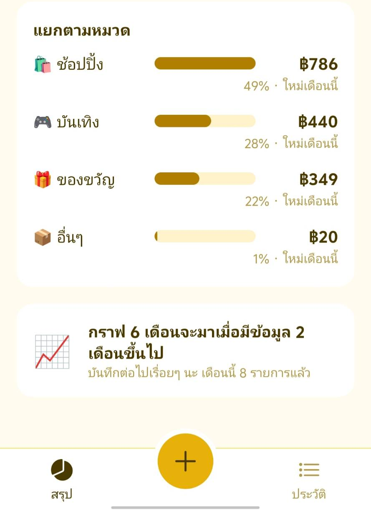
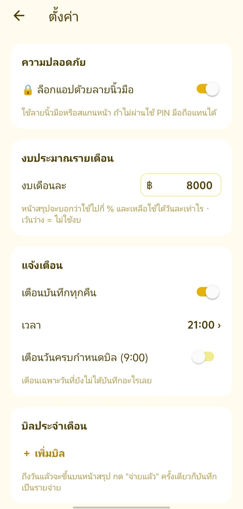

<div align="center">


# Expense — offline expense tracker for Android

A personal, privacy-first expense tracker. Every baht, slip photo and setting stays on the phone:
no server, no account, no cloud.

**React Native · Expo SDK 58 · TypeScript · SQLite**

> 🇹🇭 แอปบันทึกรายจ่ายส่วนตัวบน Android ทำงาน offline ทั้งหมด ข้อมูลและรูปสลิปอยู่ในมือถือเครื่องเดียว
> มีงบรายเดือน ปฏิทินยอดใช้ บิลประจำ แจ้งเตือน ล็อกด้วยลายนิ้วมือ และสรุปสิ้นเดือน

</div>

## Screenshots

| Summary | Add an expense | History | By category | Settings |
|:---:|:---:|:---:|:---:|:---:|
|  |  |  |  |  |

## Features

- **Fast entry** — numpad for cash, one-tap chips for things you buy often, or attach a slip/receipt photo
- **Monthly budget** — progress bar, "you can spend ฿X per day until month end", and a mascot whose mood follows your spending pace
- **Insights** — compares the last 7 days with your 4-week average and points out the category that jumped
- **Calendar heatmap** — darker days = more spending; tap a day to see its entries
- **Recurring bills** — rent, internet, phone; shows what is due and records it with one tap
- **Local notifications** — a nightly nudge only on days you haven't logged anything, plus bill due dates
- **Month-end recap** — medal (gold / silver / ribbon), top category, heaviest day, longest streak; share as an image
- **Custom categories** — add, rename, recolor, reorder; deleting one moves its entries elsewhere
- **Fingerprint lock** — with phone PIN fallback so you can't lock yourself out
- **Backup and restore** — one `.zip` (database + photos) you can keep in Google Drive or LINE; plus CSV export for Excel

## Architecture

```
┌──────────── Android phone ────────────┐
│  Expo Router screens (src/app)        │
│        │                              │
│  src/lib  ── db.ts      SQLite (expo-sqlite), migrations via PRAGMA user_version
│           ── stats.ts   budget pace, streak, calendar, insight, quick picks
│           ── bills.ts   next due date from "paid through" month
│           ── recap.ts   month-end medal and highlights
│           ── backup.ts  zip: manifest.json + expense.db + receipts/
│           ── reminders.ts / lock.ts   local notifications, biometrics
│        │                              │
│  Files: Paths.document/receipts/*.jpg │
└───────────────────────────────────────┘
```

Design decisions worth calling out:

- **Money is stored as integer satang**, never floats, so `0.1 + 0.2` can't leak into totals.
- **Dates are stored as UTC ISO strings but grouped by the phone's local day**, so a coffee at 00:10 Bangkok time lands on the right day in the calendar.
- **Reminders are scheduled day by day for the next 14 days**, not as one repeating alarm, so the app can skip tonight once you've already logged something.
- **Restore runs in a single transaction**; a broken backup file leaves current data untouched.

## The pivot: from client–server to offline

The first version was a FastAPI + PostgreSQL server in Docker on my PC, reached over Tailscale, with an LLM reading bank slips.
It worked, but daily use showed the real cost: the PC had to stay on, the VPN dropped, and "can't reach server" became the most common screen.

For a single-user app holding private financial data, the server added risk and failure points without adding value, so I rebuilt it offline-first:
the business logic (monthly summary, same-period comparison) was ported from Python to TypeScript on top of SQLite, slip photos moved to app storage,
and backup became a user-owned zip file. The server code is still in the git history.

## Testing

Business logic runs on the PC against real SQLite: a Node resolve hook swaps `expo-sqlite` for Node's built-in `node:sqlite`,
so the **same source files** the app ships are tested, with no rewrites. 45 checks cover summaries, budget pace, streaks, bill due dates,
category deletion, recap medals, CSV escaping and backup round-trips.

```bash
cd app
npm install
npm test            # node tests/run.mjs
npx tsc --noEmit
npx expo lint
```

## Run it

```bash
cd app
npx expo start --clear                                          # Expo Go
npx --yes eas-cli@latest build -p android --profile preview     # APK
```

Or download the APK from [Releases](../../releases).

## License

MIT
